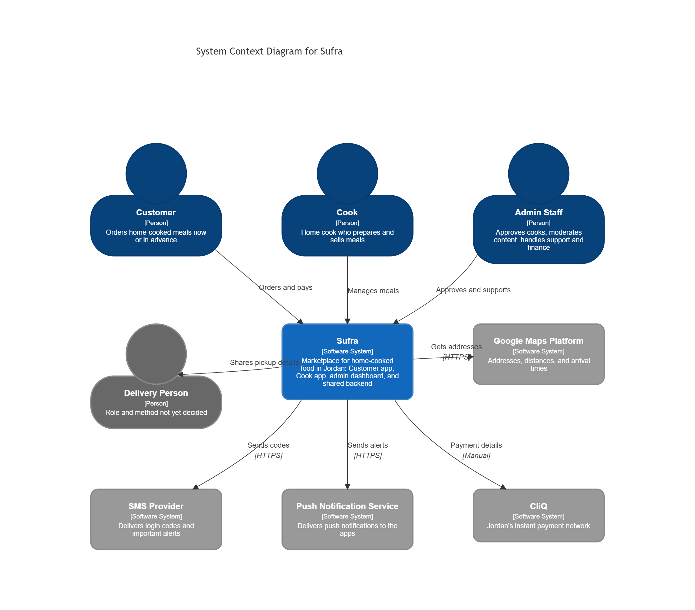

# Sufra: System Design and Software Architecture

## 1. Introduction, Goals and Requirements

### 1.1 Project Overview and Problem Statement

Sufra is a marketplace for home-cooked food in Jordan. It connects home cooks (mostly women cooking from home with spare capacity) with customers who want affordable, trustworthy, home-style meals, either ordered now or booked for a set time.

**Problem.** Customers have no convenient and trusted way to order home cooking. Restaurant apps are more expensive and less "home-style". Home cooks have no safe, low-cost channel beyond informal social media, which offers no payments, no reviews, and no dispute handling.

**System.** Two mobile apps (Customer app and Cook app), one admin web dashboard, and one shared backend. Trust is built on three things: verified kitchens, real photos taken only with the in-app camera, and reviews from customers who actually ordered.

### 1.2 Target Users and Stakeholders

| Stakeholder | Role | Main interest |
|---|---|---|
| Customer | Orders meals | Trust, price, on-time arrival |
| Cook | Prepares and sells meals | Steady orders, simple tools, privacy |
| Admin and operations staff | Onboarding, moderation, support, finance | Control and safe operations |
| Delivery person (role not yet defined) | Delivers orders | Clear pickup and handoff |
| Authorities (municipality, Ministry of Health, JFDA) | Regulate home food businesses | Compliance |
| Service providers (SMS, maps, payments, hosting) | Provide external services | Fair usage |
| Project team | Builds and operates the system | Low cost and a maintainable scope |

### 1.3 Functional Requirements (MVP = Phase 1)

**Customer app**

- FR-C1: Log in with a phone number and an SMS code. Guests can browse, and login is required at checkout.
- FR-C2: Manage addresses (map pin, landmark note, building, floor, apartment, delivery notes, label such as Home or Work) and save dietary preferences and allergens.
- FR-C3: Browse home sections, view a map of nearby kitchens (approximate locations only), and search Arabic text by dish, cook, or ingredient.
- FR-C4: Filter and sort results (price, rating, distance, diet, allergens, order type).
- FR-C5: View cook pages and meal pages (photos, allergens, price, notice time, reviews).
- FR-C6: Build a cart with items from one cook only, and see an itemized price in JOD.
- FR-C7: Place an Order Now (available portions) or a Pre-order (same day with a time window, or up to 7 days ahead).
- FR-C8: Pay by cash on delivery or CliQ, use promo codes, and add an optional tip.
- FR-C9: Track order status, see the handoff code, and cancel according to the cancellation policy.
- FR-C10: Review a delivered order (verified buyers only, one review per order) and report a problem with a photo.
- FR-C11: View order history, save favorite cooks and meals, re-order, and get invoices.
- FR-C12: Chat with the cook or support in the app, or call them, with phone numbers hidden.
- FR-C13: Delete the account and export personal data.
- FR-C14: Manage notification settings and marketing consent.

**Cook app**

- FR-K1: Register with a phone number and SMS code, upload an ID, accept the hygiene pledge, and complete a short kitchen video check. The cook goes live only after admin approval of the ID, the kitchen check, and the first menu.
- FR-K2: Create and edit meals (description, ingredients, allergens, portion, price, prep time, notice time). Photos are taken only with the in-app camera (gallery upload is blocked).
- FR-K3: Set daily portions, capacity, working hours, and online/offline status.
- FR-K4: Receive new-order notifications (no acceptance step), confirm prep time, mark orders Preparing and Ready, and verify the handoff code.
- FR-K5: Update remaining quantity, and cancel an accepted order in an emergency with a reason.
- FR-K6: View itemized earnings and commission.
- FR-K7: Reply once to each review and report abusive reviews.
- FR-K8: Use vacation mode. The cook is set to unavailable automatically after a period of inactivity while marked available.
- FR-K9: Take a live photo of a ready dish with the order number when asked for a random photo check.

**Admin dashboard**

- FR-A1: Review the sign-up queue (ID, kitchen check, first menu, photos).
- FR-A2: Review the moderation queue (flagged reviews, photo reports, fraud alerts).
- FR-A3: View orders, update delivery status manually, and cancel orders.
- FR-A4: Use support tools: order timeline and refunds.
- FR-A5: Manage finance: payouts, daily cash report, and commission settings.
- FR-A6: Manage settings (fees, cutoff times, categories, allergens), roles, and activity logs.
- FR-A7: Handle photo violations: pause meals, record strikes, and decide appeals within 48 hours.
- FR-A8: View a simple dashboard of success metrics and the order funnel.

**System-wide**

- FR-S1: Enforce the order state machine with these statuses: Created, Auto-accepted, Preparing, Ready for pickup, Picked up, On the way, Delivered, Completed, Cancelled, Failed, Refunded, Disputed.
- FR-S2: Accept orders automatically within the quantity set by the cook, without overselling.
- FR-S3: Send push notifications and SMS in Arabic.
- FR-S4: Rank cooks. The average rating is shown after 5 reviews, and new cooks get a "New cook" boost.
- FR-S5: Flag suspicious reviews automatically (offensive words, personal information, links to the cook) and alert admins to sudden review spikes.
- FR-S6: Limit the cash order value for new customers until they complete a few successful orders.
- FR-S7: Respect notification settings, marketing quiet hours, and prayer times for non-urgent notifications.
- FR-S8: Award the "Verified kitchen" badge after the ID, kitchen, and hygiene checks.

### 1.4 Main Use Cases

- UC-1: Register and log in.
- UC-2: Find a meal.
- UC-3: Place an Order Now.
- UC-4: Place a Pre-order.
- UC-5: A cook fulfils an order.
- UC-6: A customer reports a problem.
- UC-7: An admin approves a new cook.

### 1.5 Non-Functional Requirements

| ID | Requirement | Target | Applies to |
|---|---|---|---|
| NFR-1 | App start time on a mid-range Android phone | Under 3 seconds | MVP |
| NFR-2 | API response time | Under 500 ms for 95% of requests | MVP |
| NFR-3 | Search response time | Under 1 second | MVP |
| NFR-4 | Availability | 99.5% uptime | Future target |
| NFR-5 | Growth | Handle 10x order growth | Future target |
| NFR-6 | Security | Encryption in transit and at rest, secure login tokens, rate limiting, secrets management | MVP |
| NFR-7 | Privacy | Cook home address never shown to customers; compliance with Jordan's Personal Data Protection Law (2023) | MVP |
| NFR-8 | Localization | Arabic only with full right-to-left layout | MVP |
| NFR-9 | App size | Under 40 MB per app | MVP |
| NFR-10 | Cook app on weak networks | Saves changes and syncs when back online (stated in PRD Section 20; depth of offline support to be confirmed) | MVP |
| NFR-11 | Monitoring and backups | Structured logs, alerts, daily database backups | MVP |

### 1.6 Core Features and Priorities

- **Must have:** login, browsing and search, cart and checkout, Order Now, Pre-order, cash and CliQ payments, order lifecycle, cook onboarding and approval, in-app camera, notifications, basic reviews, simple admin dashboard.
- **Should have:** promo codes, tips, ranking with the "New cook" boost, customer problem reports with photos, basic offline tolerance in the Cook app (save changes locally, sync when back online).
- **Could have:** WhatsApp notifications, search that tolerates spelling mistakes.
- **Will not have in this version:** subscriptions, card payments, referral program, loyalty points, smart ranking, Driver app, English interface.

### 1.7 Boundaries, MVP Scope, and Out of Scope

**In scope (Phase 1, invite-only beta):** everything listed in Section 1.3.

**Out of scope:**

- Grocery or raw ingredient delivery.
- Restaurants and cloud kitchens (cooks must be individuals cooking from home).
- Driver app and delivery job board (postponed).
- Cooking classes and social feeds.
- Operating outside Jordan.
- All Phase 2 and Phase 3 features (subscriptions, card payments, referral, loyalty, smart ranking, group orders).

The architecture must allow these features to be added later without a rewrite.

### 1.8 Assumptions and Success Criteria

**Assumptions**

- A-1: The delivery method is not yet decided. Delivery is therefore treated as a replaceable capability. Each order carries a fulfilment type, and delivery statuses are updated manually by admins in the MVP.
- A-2: The licensing route for home cooks will be clarified before any real sale.
- A-3: Expected load is about 200 orders per day at Phase 3 volume (6,000 orders per month). We assume a peak of about 100 concurrent users. This figure is our own estimate and must be validated.
- A-4: Each cart contains items from one cook only.
- A-5: CliQ payments are reconciled manually at launch.
- A-6: The data hosting location depends on legal advice.
- A-7: The development team is small and works part-time.

**Success criteria** (from the product requirements)

| Metric | Target |
|---|---|
| Order completion rate | 95% or more |
| Repeat order within 30 days | 45% or more |
| Average order rating | 4.5 or more |
| On-time arrival | 92% or more |
| Photo reports | Under 1% of orders |

Architecture-level criterion: a developer who joins the project can understand its structure and start implementation without guessing how the system is supposed to work.

## 2. Architecture Constraints

### 2.1 Technical Constraints

| ID | Constraint | Source |
|---|---|---|
| TC-1 | Arabic only, with full right-to-left layout | PRD Section 5 |
| TC-2 | Android first (mid-range devices), iPhone in parallel | PRD Section 5 |
| TC-3 | Must work on weak and variable connections | PRD Sections 5 and 20 |
| LC-4 | Where data is hosted may need to follow legal requirements (Jordan or an approved region) | Pending legal advice |
| TC-5 | Google Maps is the main map provider | PRD Section 5 |
| TC-6 | Login by SMS code to +962 phone numbers | PRD Section 5 |
| TC-7 | Each app stays small (target under 40 MB) | PRD Section 20 |
| TC-8 | Money is in Jordanian Dinar with 3 decimals | PRD Section 5 |

### 2.2 Organizational Constraints

| ID | Constraint | Impact |
|---|---|---|
| OC-1 | Small part-time student team, slower during exams | Favors a simple, modular design |
| OC-2 | Task 01 delivery is due on 7 November 2026 | Limits the depth of this document |
| OC-3 | Phased roadmap, with the Phase 1 beta first | MVP-first architecture |
| OC-4 | This task is design only, with no implementation | Focus on reasoning and documentation |

### 2.3 Financial Constraints

| ID | Constraint | Impact |
|---|---|---|
| FC-1 | Running costs stay under JOD 1,000 per month until order volume justifies more (JOD 250 to 600 estimated during the beta, plus JOD 200 to 500 for marketing) | Managed services and usage limits |
| FC-2 | Free tiers early, and no paid ads before retention is proven | Hosting and tool choices |
| FC-3 | Apple developer account USD 99 per year, Google Play fee USD 25 once | Release costs |

Source for FC-1 to FC-3: PRD Sections 3.2 and 23.

### 2.4 Legal and Regulatory Constraints

| ID | Constraint | Status |
|---|---|---|
| LC-1 | Licensing route for home food businesses | Unknown, to be clarified in Phase 0 |
| LC-2 | Jordan Personal Data Protection Law (2023) | Applies to all apps |
| LC-3 | Payment rules (Central Bank of Jordan), sales tax, and consumer protection | To be verified |
| LC-4 | The location where data is hosted may be restricted | Pending legal advice |

Source: PRD Sections 5 and 20.

### 2.5 Operational and Third-Party Constraints

- OP-1: The delivery method is undecided (PRD Section 26, question 5).
- OP-2: CliQ payments are reconciled manually at launch.
- OP-3: The system depends on external providers: Google Maps, an SMS provider that supports Jordan, a push notification service, and a payment provider.

### 2.6 Constraints vs. Free Decisions

The PRD only suggests the following items. They are not constraints. The team decides them and justifies them in Section 4 and in the architecture decision records.

| Topic | Options considered |
|---|---|
| Mobile framework | Flutter, React Native, native apps |
| Backend | Ready-made backend service vs. custom service (Node.js, Python, Go) |
| Database | PostgreSQL vs. other options |
| API style | REST with OpenAPI vs. GraphQL |
| Hosting | Managed platform vs. virtual server vs. backend-as-a-service |
| Admin dashboard | Ready-made admin framework vs. custom web app |

## 3. System Context and Scope

### 3.1 Purpose

This section shows how Sufra interacts with the people who use it and with external systems. Sufra is shown as a single system. Its internal structure is described in Section 5.

### 3.2 System Context Diagram (C4 Level 1)

_Figure 3.1: System Context Diagram for Sufra. Editable source: `diagrams/c4-01-system-context.mmd`._

The diagram shows Sufra in the center, the people who use it, and the external systems it depends on. Each arrow points from the party that starts an interaction to the party that receives it.

### 3.3 System Boundary

**Inside the boundary** (built and operated by the team): the Customer app, the Cook app, the admin dashboard, and the shared backend.

**Outside the boundary:** the people listed in 3.4 and the external systems listed in 3.5.

### 3.4 User Roles

| Role | Description | Main interactions with Sufra |
|---|---|---|
| Customer | Orders home-cooked meals now or in advance | Browses cooks and meals, places Order Now and Pre-orders, pays by cash or CliQ, tracks orders, reviews meals, reports problems |
| Cook | Home cook who prepares and sells meals | Registers and gets verified, creates meals with in-app camera photos, sets portions and availability, prepares orders, views earnings |
| Admin Staff | Support, quality, onboarding, and finance staff | Approves cooks and menus, moderates reviews and photos, supports users, updates delivery status manually, manages payouts and settings |
| Delivery Person (external) | Role and method not yet decided (assumption A-1) | Receives pickup and drop-off details and confirms handoff with a code |

### 3.5 External Dependencies

| External system | Purpose | Interaction | Notes |
|---|---|---|---|
| Google Maps Platform | Addresses, distances, and arrival times | HTTPS | Usage limits and caching are needed to control cost |
| SMS Provider | Login codes and important alerts | HTTPS | Must support +962 phone numbers |
| Push Notification Service | Notifications to the apps, including new-order alerts for cooks | HTTPS | Works on Android and iPhone |
| CliQ | Instant bank payments | Manual | CliQ |

### 3.6 Scope Notes

- **Authorities** (municipality, Ministry of Health, JFDA) are stakeholders (Section 1.2) but do not interact with the system directly, so they are not in the diagram.
- **WhatsApp Business messages** are a "Could have" feature (Section 1.6) and are not shown.
- **Card payments** are planned for Phase 2. When added, a payment gateway will appear as a new external system.
- **Delivery** is shown as an external person because the method is still undecided. The diagram will change once the decision is made.
## 4. Solution Strategy

_To be written._

## 5. Building Block View

_To be written._

## 6. Runtime View and System Behavior

_To be written._

## 7. Data Architecture

_To be written._

## 8. API Design and Communication

_To be written._

## 9. Deployment and Infrastructure

_To be written._

## 10. Security and Quality Requirements

_To be written._

## 11. Architecture Decisions, Trade-offs and Risks

_To be written._

## 12. Cross-Cutting Concepts and Glossary

_To be written._